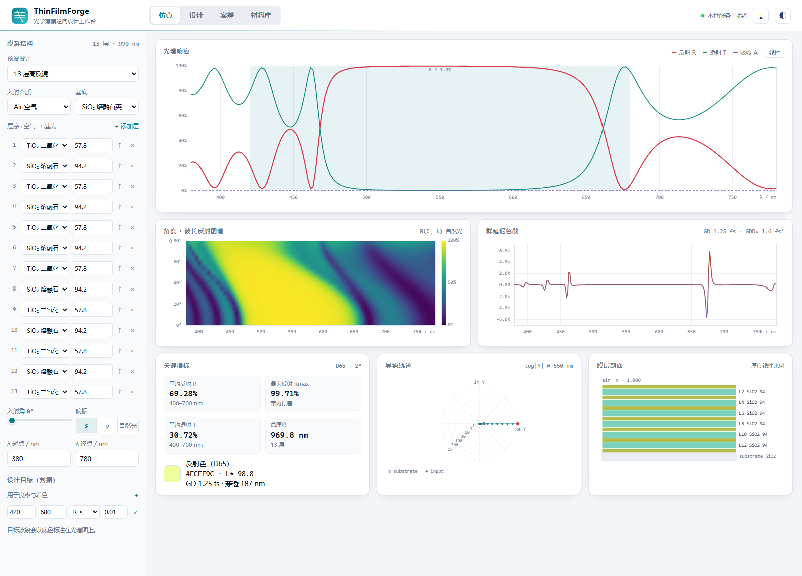
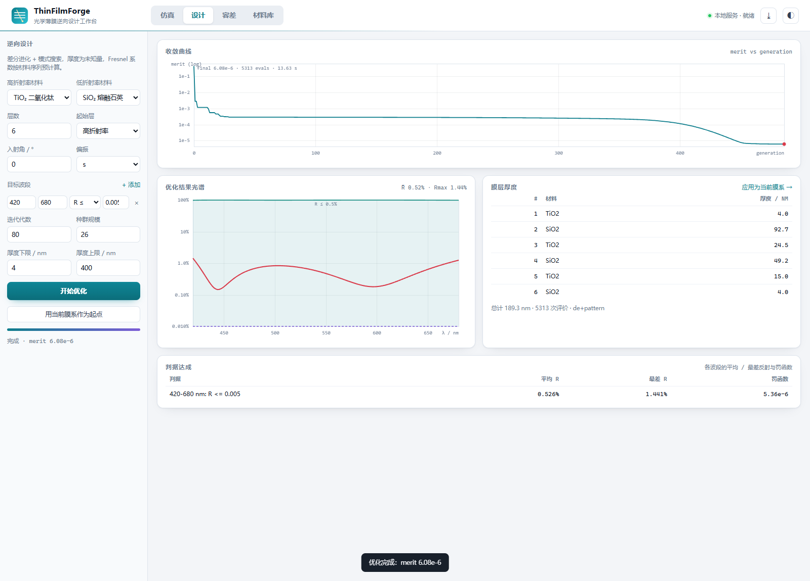
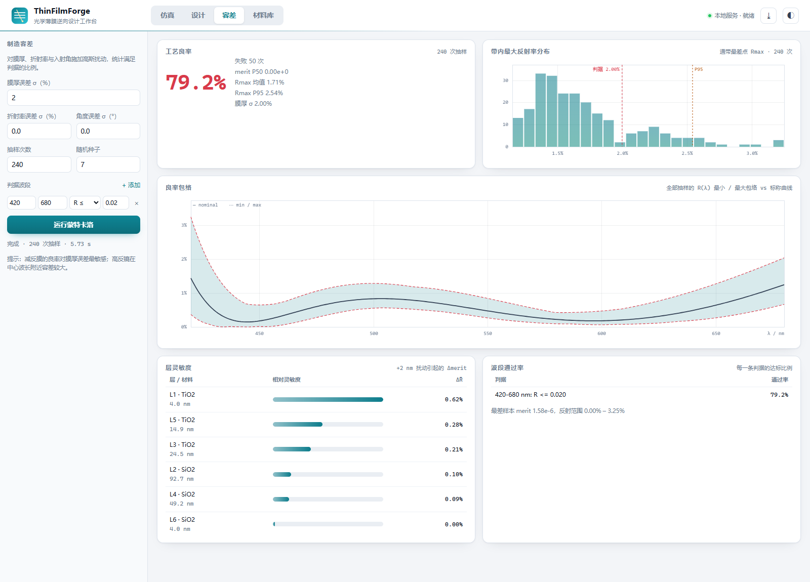

# ThinFilmForge · 光学薄膜设计与逆向优化工作台

<p align="left">
  
  
  
  
  <a href="https://github.com/18971181532/thinfilm-forge/actions/workflows/tests.yml">
    
  </a>
</p>

> 给定一条光谱判据（"420–680 nm 反射率低于 0.5%"、"520–700 nm 反射率高于 97%"），
> 反解出每一层膜的物理厚度，并把结果直接放到可交互的浏览器工作台里。
> 纯 Python 标准库实现，**零第三方依赖**，离线可用。



---

## 1. 项目简介

光学薄膜是光电专业最"落地"的方向之一：一片手机镜头、一块激光反射镜、一枚窄带滤光片，
本质都是十几层纳米级介质堆叠出来的光谱选择器。工业上设计这类膜系主要依赖
MacLeod 的**导纳图法**加商业软件（TFCalc / Essential Macleod），学习曲线陡、授权昂贵，
而且"设计"与"分析"通常是分离的两个环节。

**ThinFilmForge** 试图把这条链路做成一个完整、可读、可扩展的开源工具：

| 环节 | 传统做法 | 本项目 |
| --- | --- | --- |
| 正问题（算光谱） | 特征矩阵手算 / 商业软件 | 稳定的 Airy 递归求解器，附特征矩阵交叉验证 |
| 反问题（定厚度） | 经验 + 手动调导纳图 | 差分进化 + 模式搜索的混合优化器，秒级收敛 |
| 可制造性 | 靠经验留余量 | 蒙特卡洛良率、膜厚/折射率/角度误差、层灵敏度排序 |
| 结果表达 | 一张 R(λ) 曲线 | 光谱 + 角度图谱 + 群延迟色散 + CIE 颜色 + 导纳轨迹 |
| 使用方式 | GUI 点选 | CLI / Python API / 本地 Web 工作台，三者同源 |

它同时是一个**教学工具**：所有物理量（复折射角、导纳、相位厚度、群延迟）都在代码里显式写出，
可以对照公式逐行阅读；`tests/` 中的解析解校验让"算得对不对"可被机器验证。

---

## 2. 核心功能

- **多层膜正演**：任意层数、任意材料序列、s / p / 自然光、0–89° 斜入射、复折射率（含金属吸收）。
- **七种预设膜系**：单层 MgF₂ 减反、六层宽带减反、13 层四分之一波长高反镜、铝反射镜、法布里-珀罗窄带滤光片、啁啾镜、长波通截止滤光片。
- **逆向设计**：以波段判据为目标，优化各层厚度；支持多角度平均、厚度上下限、固定层、总厚度正则。
- **光谱后处理**：带内均值/最值/RMS、反射色（D65 + CIE 1931 → sRGB / CIELAB）、群延迟 GD 与色散 GDD、穿透深度、谐振峰与 FWHM。
- **角度-波长二维图谱**：R(θ, λ) 热力图，直观看到阻带随入射角蓝移。
- **导纳轨迹**：对数量级的复平面导纳图，既能看 1% 减反膜的小圆，也能看 99.7% 高反镜的螺旋。
- **容差分析**：膜厚（相对/绝对）、折射率、入射角高斯扰动下的良率、光谱包络、逐层灵敏度。
- **三种入口**：`thinfilm` CLI、`import thinfilmforge`、`python run.py serve` 本地工作台。
- **零依赖**：不需要 numpy / scipy / matplotlib，标准库即可运行；前端手写 Canvas 图表，无 CDN。

---

## 3. 物理模型与算法

### 3.1 多层膜求解：稳定的 Airy 递归

对第 $j$ 层，相位厚度

$$\delta_j=\frac{2\pi}{\lambda}n_j d_j\cos\theta_j,\qquad
\eta_j=\begin{cases}n_j\cos\theta_j & s\\ n_j/\cos\theta_j & p\end{cases}$$

界面上的振幅反射/透射用同一组菲涅耳公式（$s$、$p$ 只差导纳定义）：

$$r_j=\frac{\eta_j-\eta_{j+1}}{\eta_j+\eta_{j+1}},\qquad t_j=\frac{2\eta_j}{\eta_j+\eta_{j+1}}$$

从基底向上递推（Airy 求和）：

$$\rho_j=\frac{r_j+\rho_{j+1}e^{2i\delta_j}}{1+r_j\rho_{j+1}e^{2i\delta_j}},\qquad
\tau_j=\frac{t_j\,\tau_{j+1}e^{i\delta_j}}{1+r_j\rho_{j+1}e^{2i\delta_j}}$$

$$R=|\rho_0|^2,\qquad T=|\tau_0|^2\frac{\operatorname{Re}\eta_{\rm sub}}{\operatorname{Re}\eta_0}$$

这样写而不是直接连乘 2×2 特征矩阵，是因为**每个指数因子都满足 $|e^{2i\delta}|\le 1$**：
吸收层只会让波衰减，不会让矩阵元指数爆炸。2 mm 厚的硅片也能稳定求解（见 `test_tmm.py`）。
特征矩阵解法保留在 `reflectance_matrix()` 中，用作交叉验证——25 组随机膜系、两种偏振、
三个波长上两者一致到 $10^{-9}$，这比"看起来像对的曲线"更让人放心。

复折射角由 Snell 定律解析延拓：$\cos\theta_j=\sqrt{1-(n_0\sin\theta_0/n_j)^2}$，取主值分支
（$\operatorname{Re}\ge 0$）。这样全反射时自动得到 $\operatorname{Im}>0$ 的倏逝波、$T=0$。

### 3.2 逆向设计：差分进化 + 模式搜索

设计变量是各层物理厚度 $\mathbf d$，目标函数为

$$f(\mathbf d)=\sum_{\text{band}} w_b\cdot\frac{1}{|I_b|}\sum_{\lambda\in I_b}
\Big[\underbrace{\max(0,R_\lambda-v_b)^2}_{\text{违反量}}
+\underbrace{\epsilon R_\lambda^2}_{\text{余量项}}\Big]$$

第二项很关键：如果只惩罚"超标"，一旦所有采样点都满足判据，目标函数就变成平的，
优化器会停在一个"刚好达标、没有余量"的解上。加入极小的余量项相当于给可行域一个斜坡，
让解向更深的极小值滑动，同时不改变判据语义（判据仍由 `passes_spec` 单独判定）。

- **初始化**：以用户膜系为种子，混合对数正态扰动与"薄层偏向"的均匀采样。
  纯均匀初始化在厚度 4–400 nm 的箱子里会得到一堆"镜子"，收敛极慢——这是实测踩过的坑。
- **全局搜索**：DE/best/1/bin，$F\in[0.4,1.0]$ 抖动，交叉率 0.9，贪心选择。
- **局部精修**：Hooke–Jeeves 模式搜索，步长逐次减半至 0.05 nm。
- **加速**：材料序列固定后，界面菲涅耳系数与"单位厚度相位"$q_j(\lambda)$ 都与厚度无关，
  `StackModel` 预先算好，单次评价只做 `exp(2i·q·d)` 与两次复数乘——比重复调用完整求解器快约一个数量级。
  这是纯 Python 也能在几秒内完成 20 层优化的原因。

### 3.3 色度学

CIE 1931 观察者用 Wyman–Sloan–Shirley 的多瓣高斯解析拟合，D65 用 10 nm 表插值，
积分前把光谱重采样到 1 nm（否则粗网格会把颜色算飞）。输出 sRGB（含色域压缩）、
CIE xy、CIELAB 与 $L^*$。一块反射 500–620 nm 的高反镜会被算成 `#ECFF9C`（黄绿），
和肉眼看到的外观一致。

### 3.4 群延迟与色散

$$\mathrm{GD}=-\frac{d\varphi}{d\omega},\qquad \mathrm{GDD}=\frac{d\,\mathrm{GD}}{d\omega}$$

相位先解缠再中心差分；对反射镜还可给出等效穿透深度 $L=c\cdot\mathrm{GD}/2$。
啁啾镜预设会给出 ±200 fs² 的振荡色散曲线——这正是飞秒脉冲压缩需要的量。

### 3.5 容差

对每层厚度、材料折射率、入射角施加独立高斯扰动，逐次全量重解，统计：

- 良率（全部判据满足的样本比例）；
- 带内最差反射率（通带取 $R_{\max}$、停带取 $R_{\min}$）的分布，直接看出"离失效还有多远"；
- R(λ) 的最小/最大包络；
- 逐层灵敏度（±2 nm 引起的带内平均 $|\Delta R|$）。

---

## 4. 环境与依赖

- Python **3.9+**（仅标准库；Windows / macOS / Linux 均可）
- 任意现代浏览器（Chrome / Edge / Firefox / Safari），用于本地工作台
- 无需 numpy、scipy、matplotlib，也无需前端构建工具

---

## 5. 安装与运行

```bash
git clone https://github.com/18971181532/thinfilm-forge.git
cd thinfilm-forge

# 方式 A：直接运行（无需安装）
python run.py --help

# 方式 B：可编辑安装，获得 thinfilm 命令
python -m pip install -e .
thinfilm --help
```

> `run.py` 会把项目根目录加入 `sys.path`，因此在嵌入式 / 便携版 Python
> （存在 `python310._pth`、不自动包含工作目录）下也能直接使用。

### 5.1 启动 Web 工作台

```bash
python run.py serve            # 默认 http://127.0.0.1:8777
python run.py serve --port 9000 --no-browser
```

浏览器里可以：拖入射角、增删膜层、改材料、切换 s/p/自然光、切换线性/对数纵轴；
在「设计」页跑优化并实时看收敛曲线；在「容差」页看良率包络；在「材料库」页看色散曲线。
所有计算都在本机完成，不联网。

### 5.2 命令行

```bash
# 材料库 / 预设
python run.py materials
python run.py presets

# 正演：光谱、颜色、群延迟
python run.py simulate --preset ar_broadband --range 420 680
python run.py simulate --stack examples/edge_stack.json --theta 45 --pol avg --csv out.csv

# 逆向设计：目标写在 --band 里
python run.py design --stack examples/ar_stack.json \
    --band 420:680:max:0.004 --iterations 120 --out ar_opt.json

# 从零开始：指定材料池与层数
python run.py design --materials TiO2 SiO2 --layers 11 --band 500:600:min:0.98

# 容差
python run.py tolerance --stack examples/edge_stack.json \
    --band 400:470:max:0.03 --band 520:700:min:0.95 --runs 300 --sigma 1.5
```

`--band` 语法：`起始波长:终止波长:类型:目标值[:权重]`，类型为 `max` / `min` / `target`。

### 5.3 Python API

```python
import thinfilmforge as tff

# 1) 正演：13 层四分之一波长高反镜
mirror = tff.quarter_wave_stack("TiO2", "SiO2", lam0=550, pairs=6)
res = tff.simulate(mirror, [550.0], theta_deg=0, pol="s")
print(f"R = {res.R[0]:.4f}")          # R = 0.9971

# 2) 逆向设计：把六层宽带减反膜继续压到 0.5% 以下
stack = tff.Stack.from_dict(tff.preset("ar_broadband")["stack"])
spec = tff.DesignSpec([tff.BandTarget(420, 680, "max", 0.005)])
design = tff.design(stack, spec, maxiter=120, time_budget=20)
print(design.thicknesses, f"{design.merit:.2e}")   # 0.18% 平均反射

# 3) 容差：1% 膜厚误差下的良率
report = tff.tolerance_report(
    tff.Stack.from_dict(design.stack),
    [tff.BandTarget(420, 680, "max", 0.02)],
    runs=300, thickness_sigma=1.0)
print("yield", report["yield"], "%")    # yield 100.0 %
```

---

## 6. 使用示例

### 6.1 六层宽带减反膜

```text
$ python run.py simulate --preset ar_broadband --range 420 680
Stack: ar_broadband  |  6 layers  |  280.0 nm total
Ambient Air -> BK7, theta = 0.0 deg, pol = s
--------------------------------------------------------------
  L1  TiO2         4.00 nm
  L2  SiO2        72.50 nm
  L3  TiO2       114.20 nm
  L4  SiO2        37.60 nm
  L5  TiO2        13.20 nm
  L6  SiO2        38.50 nm
--------------------------------------------------------------
R: avg 0.185%  min 0.091%  max 0.440%  (420-680 nm)
T: avg 99.815%  max 99.909%
Appearance under D65: #050707   CIE xy = (0.2914, 0.3265)   L* = 1.7
Group delay -0.69 fs at band centre -> penetration depth 103.9 nm
```

未经优化的 BK7 裸片反射 4.2%；六层膜把 420–680 nm 的平均反射压到 **0.18%**，
相当于一片可见光宽带增透膜。

### 6.2 长波通截止滤光片（含容差）

20 层 TiO₂/SiO₂ 设计：400–470 nm 平均反射 1.2%，520–700 nm 平均 99.3%。
把膜厚误差设为 1.5% 后：

```text
$ python run.py tolerance --stack examples/edge_stack.json \
      --band 400:470:max:0.03 --band 520:700:min:0.95 --runs 150 --sigma 1.5
yield               0.7%  (149 failures)
  400-470 nm: R <= 0.030         pass   0.7%
  520-700 nm: R >= 0.950         pass  96.7%
layer sensitivity (mean |dR| for +2 nm):
  L1  TiO2       82.00 nm   dR 0.239%   dMerit +2.81e-05
  L5  TiO2       86.00 nm   dR 0.214%   dMerit +1.96e-05
  L15 TiO2       62.00 nm   dR 0.212%   dMerit +3.36e-07
```

停带几乎不受影响（96.7% 通过），通带却几乎全军覆没——截止滤光片对膜厚误差的敏感性
是光学薄膜工艺里最经典的教训之一。工具把这个"反直觉"直接量化出来了。

### 6.3 Web 工作台

| 页面 | 能做什么 |
| --- | --- |
| **仿真** | 编辑膜系、扫入射角、看 R/T/A 光谱、角度图谱、GDD、导纳轨迹、膜层剖面、D65 外观色 |
| **设计** | 设定波段判据与材料池，后台跑优化，实时显示 merit 收敛、结果厚度表、判据达成情况 |
| **容差** | 设定误差模型与判据，得到良率、包络图、最差反射率分布、逐层灵敏度 |
| **材料库** | 18 种材料的 n(λ)、k(λ) 曲线与说明 |

<table>
<tr>
<td width="50%"></td>
<td width="50%"></td>
</tr>
<tr>
<td align="center"><sub>逆向设计：merit 收敛、结果厚度、判据达成</sub></td>
<td align="center"><sub>容差：良率、光谱包络、最差反射率分布、层灵敏度</sub></td>
</tr>
</table>

光谱图右上角的「线性 / 对数」按钮值得一试：减反膜的 0.2% 与高反镜的 99.99%
在同一个纵轴上都没法看，对数轴可以同时容纳两者（0.01%–100%）。

---

## 7. HTTP API

服务端是 `http.server` 上的极简路由，所有响应均为 JSON。

| 方法 | 路径 | 说明 |
| --- | --- | --- |
| GET | `/api/health` | 版本、运行时长 |
| GET | `/api/materials` | 材料库（含 380–780 nm 的 n/k 采样） |
| GET | `/api/presets` | 预设膜系 |
| POST | `/api/simulate` | 光谱、颜色、GDD、角度图谱、导纳轨迹、谐振峰 |
| POST | `/api/design` | 提交优化任务，返回 `jobId` |
| GET | `/api/design/<jobId>` | 轮询进度 / 结果 |
| POST | `/api/tolerance` | 蒙特卡洛良率（同步） |

```bash
curl -s http://127.0.0.1:8777/api/simulate -H 'Content-Type: application/json' -d '{
  "stack": {"incident":"Air","substrate":"BK7",
            "layers":[{"material":"MgF2","thickness":99.7}]},
  "range": [400, 700], "points": 121, "theta": 0, "pol": "s"
}' | python -m json.tool | head -20
```

优化在后台线程执行，前端每 450 ms 轮询；单个任务有超时预算，不会把服务拖死。

---

## 8. 目录结构

```text
thinfilm-forge/
├── run.py                     # 无安装启动入口（嵌入式 Python 友好）
├── pyproject.toml             # 打包与 thinfilm 命令
├── README.md
├── LICENSE                    # MIT
├── thinfilmforge/
│   ├── __init__.py            # 公共 API
│   ├── materials.py           # 18 种材料 + Sellmeier/Cauchy/表格/缩放
│   ├── stack.py               # Layer / Stack / 解析 / 7 个预设
│   ├── tmm.py                 # Fresnel、相位厚度、Airy 递归、特征矩阵
│   ├── metrics.py             # 带统计、GD/GDD、导纳轨迹、峰值
│   ├── color.py               # CIE 1931 / D65 / sRGB / CIELAB
│   ├── design.py              # 判据、StackModel、DE + 模式搜索
│   ├── tolerance.py           # 蒙特卡洛、包络、灵敏度
│   ├── cli.py                 # 命令行
│   ├── server.py              # HTTP 服务与 JSON API
│   └── web/
│       ├── index.html         # 单页工作台
│       ├── style.css          # 明/暗双主题
│       └── app.js             # 手写 Canvas 图表 + 交互
├── docs/
│   ├── PUBLISHING.md          # 上传 GitHub / 发布版本的完整清单
│   └── images/                # 界面截图
├── examples/                  # 可复现的膜系与判据 JSON
├── tests/                     # 48 个单元测试
└── .github/workflows/tests.yml# CI：Python 3.9-3.12 跑测试与 CLI 冒烟
```

数据流：

```text
stack.json ──► Stack ──► StackModel(材料序列, 角度, 偏振)
                            │ 预计算 r_interface, q(λ)
                            ▼
        DesignSpec(bands) ──► merit(d) ──► DE ──► pattern search ──► thicknesses
                                                                    │
                              ┌─────────────────────────────────────┘
                              ▼
                   simulate(fine grid) ──► R/T/A ──► 指标 / 颜色 / GDD / 导纳
                                              └──► Monte-Carlo ──► 良率 / 包络
```

---

## 9. 测试

```bash
python -m unittest discover -s tests -t .
```

48 个测试，覆盖三类内容：

1. **解析解**：裸界面 $R=((n_0-n_s)/(n_0+n_s))^2$；布儒斯特角处 $R_p<10^{-6}$；
   四分之一波长堆的闭式 $R$；1 μm 石英片的群延迟 $n_gL/c$。
2. **求解器一致性**：25 组随机膜系上 Airy 递归 vs 特征矩阵，误差 < 1e-9；
   零厚度层应退化为直接界面；2 mm 吸收层不发散。
3. **行为契约**：优化后 merit 必须下降、厚度必须落在边界内、固定层不得变动、
   同种子结果可复现、良率随误差增大而下降、颜色白点必须是 D65 白。

---

## 10. 材料数据与适用边界

材料库是**设计级近似**，不是工艺标定数据：

- 熔融石英、MgF₂、蓝宝石、N-BK7 用文献 Sellmeier 系数（Malitson / Dodge / Schott）；
- TiO₂、Ta₂O₅、Nb₂O₅、HfO₂、Si₃N₄、ZrO₂、PMMA 用 Cauchy 拟合，对应电子束蒸发 / 离子辅助工艺的典型值；
- Al、Ag、Au、Si 用 Palik 数据的分段线性插值（金属未包含自然氧化层）。

真实膜层的折射率与密度、化学计量比、应力、粗糙度强相关，不同机台可能相差 1–3%。
**做实际镀膜前，请用椭偏仪测出自己的 n(λ)、k(λ)**，通过
`materials.load_user_library("my_films.json")` 注册后使用（格式见函数文档）。

当前模型的其他边界：

- 完全相干叠加，不处理厚基底的双面非相干多次反射（可把背面当作粗糙面另算）；
- 不含散射、界面粗糙度（Nevot–Croce 因子）与膜厚横向不均匀；
- 各向同性、无色散梯度膜；金属只用于反射结构；
- 优化是局部/半全局搜索，层数过少时可能无解——CLI 会明确提示"判据未满足"。

---

## 11. 性能参考

在普通笔记本电脑（单核 Python 3.10）上：

| 任务 | 规模 | 耗时 |
| --- | --- | --- |
| 单波长求解 | 13 层 | ≈ 0.1 ms |
| 201 点光谱 + 角度图谱 + GDD | 13 层 | ≈ 0.4 s |
| 六层减反设计 | 1000+ 次评价 | ≈ 0.5–2 s |
| 20 层长波通设计 | 约 6000 次评价 | ≈ 9 s |
| 240 次蒙特卡洛（71 波长） | 20 层 | ≈ 5 s |

---

## 12. 路线图

- [ ] Needle / 针法合成：自动插入薄层，摆脱"层数必须预先给定"的限制
- [ ] 非相干基底与双面镀膜
- [ ] Nevot–Croce 界面粗糙度、膜厚横向均匀性
- [ ] 椭偏仪数据拟合（从 ψ/Δ 反演 n、k、d）
- [ ] 导出 Zemax / CODE V 兼容的膜层表
- [ ] 把优化器换成可插拔的后端（CMA-ES、贝叶斯优化）

---

## 13. 许可

MIT License，见 [LICENSE](LICENSE)。欢迎开 Issue 讨论膜系设计或直接提 PR。

> 本项目为学习与工程原型用途；用于实际产品或高功率激光系统前，
> 请自行完成工艺验证与损伤阈值评估。
